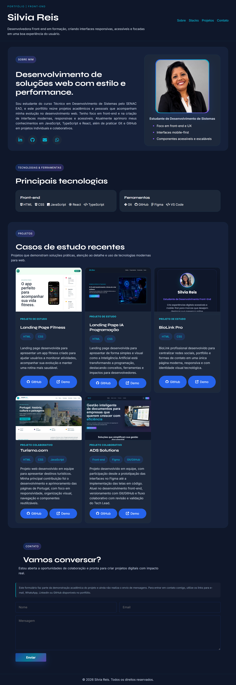

# ✨ TrendsIT 2026 — Portfólio Silvia Reis

<p align="center">
  Portfólio acadêmico em evolução, desenvolvido para apresentar meus estudos,
  projetos e experiências colaborativas em desenvolvimento front-end.
</p>

---

## 🚀 Sobre o Projeto

O **Portfólio TrendsIT 2026** surgiu como um projeto acadêmico e continua sendo
aprimorado conforme avanço nos meus estudos em desenvolvimento de sistemas.

Atualmente, ele reúne projetos de estudo e experiências colaborativas,
permitindo acompanhar minha evolução no desenvolvimento web e na criação de
interfaces modernas, responsivas e acessíveis.

O projeto foi desenvolvido com foco em:

- 🎨 Interface moderna e organizada
- 📱 Layout responsivo para diferentes dispositivos
- ♿ Acessibilidade e usabilidade
- ⚡ Navegação simples e intuitiva
- 🧩 Estrutura organizada e de fácil manutenção
- 🎯 Apresentação da minha evolução profissional

---

## 🛠️ Tecnologias e Ferramentas


---

## 🛠️ Funcionalidades

✅ Navegação entre seções  
✅ Área de apresentação profissional  
✅ Cards para projetos de estudo e colaborativos  
✅ Links para repositórios no GitHub e demonstrações online  
✅ Layout responsivo  
✅ Links diretos para redes e canais profissionais  
✅ Formulário acadêmico demonstrativo  
✅ Aviso informando que o formulário ainda não realiza envio de mensagens  
✅ Estrutura organizada e de fácil manutenção  

---

## 📚 Projetos apresentados

O portfólio reúne atualmente projetos de estudo e projetos desenvolvidos
em colaboração com outras equipes.

Entre eles:

- Landing Page Fitness — projeto de estudo
- Landing Page IA Programação — projeto de estudo
- BioLink Pro — projeto de estudo
- Turismo.com — projeto colaborativo
- ADS Solutions — projeto colaborativo

Nos projetos colaborativos, participei de atividades como desenvolvimento
front-end, criação e implementação de interfaces, responsividade,
versionamento com Git/GitHub e trabalho em equipe.

---

## 📂 Estrutura do Projeto

```bash
portfolio-front-end-silvia-reis
│
├── index.html
├── style.css
├── assets
│   └── img
│       ├── silvia-reis.jpeg
│       ├── landing-page-fitness.png
│       ├── IA-programacao.png
│       ├── biolink-pro-preview.png
│       ├── turismo-com-portugual.png
│       └── adi-solutions.png
└── README.md
```

---

## ▶️ Como Executar Localmente

Clone o repositório:

```bash
git clone https://github.com/Silviareis1/portfolio-front-end-silvia-reis.git
```

Acesse a pasta:

```bash
cd portfolio-front-end-silvia-reis
```

Abra o arquivo `index.html` diretamente no navegador ou utilize uma extensão
como **Live Server** no VS Code.

---

## 🌐 Demonstração

O projeto está publicado no GitHub Pages:

**https://silviareis1.github.io/portfolio-front-end-silvia-reis/**

---

## 📱 Responsividade

O layout foi desenvolvido para se adaptar a diferentes tamanhos de tela,
proporcionando uma experiência consistente em:

- Smartphones
- Tablets
- Notebooks
- Monitores widescreen

---

## 🌟 Objetivos do Projeto

Este portfólio tem como objetivos:

- Registrar minha evolução no desenvolvimento web
- Apresentar projetos acadêmicos e colaborativos
- Demonstrar conhecimentos em desenvolvimento front-end
- Aplicar conceitos de responsividade, acessibilidade e UI/UX
- Consolidar práticas de HTML, CSS, Git e GitHub
- Construir gradualmente minha presença profissional na área de tecnologia

---

## 📸 Preview

<p align="center">
  
</p>

---

## 👩‍💻 Autora

### Silvia Reis

Desenvolvedora Front-end em formação e estudante de Desenvolvimento de Sistemas,
com interesse em interfaces responsivas, acessibilidade, experiência do usuário
e desenvolvimento web.

---

<p align="center">
  Desenvolvido com 💙 por Silvia Reis
</p>
